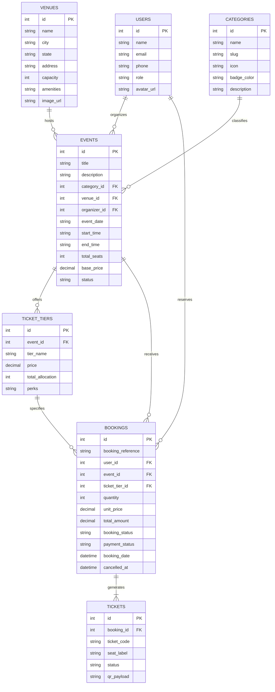
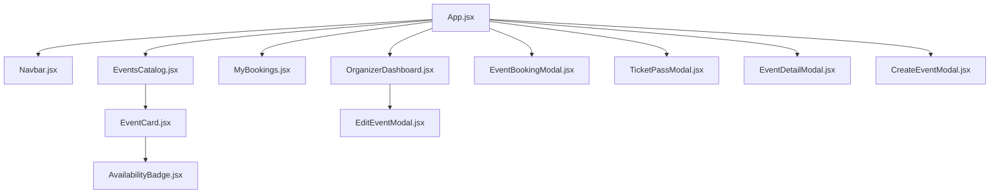

# EventSphere — Technical Specification, Architecture & Implementation Manual

---

## 1. Executive Summary & System Overview

**EventSphere** is an enterprise-grade, full-stack Event Management and Ticket Reservation Platform. Built with a reactive **React 18** frontend, a high-performance **Node.js/Express** backend, and an ACID-compliant **MySQL 8.0** relational database, the platform provides an end-to-end event ticketing experience covering:

- Multi-faceted event discovery, filtering, and live search.
- Multi-tier ticket booking with real-time seat validation.
- Instant digital pass issuance with unique references, ticket codes, seat assignments, and scannable visual barcodes.
- Self-service cancellation workflows with automatic, dynamic seat capacity restoration.
- Comprehensive Organizer Hub for scheduling, editing, deleting events, tracking occupancy, and viewing attendee guest manifests.
- High-performance relational database architecture featuring normalized schemas, foreign key constraint enforcement, and transactional integrity.

---

## 2. Complete Technology Stack & Tooling Breakdown

### 2.1. Frontend Tier

- **Framework & Runtime**: React 18.3.1 running modern functional components with React Hooks (`useState`, `useEffect`).
- **Build Tool & Bundler**: Vite 6.0.1 with `@vitejs/plugin-react` providing Hot Module Replacement (HMR) and optimized esbuild bundling.
- **Iconography**: `lucide-react` (v1.16.0) delivering tree-shaken SVG vector icons.
- **Styling Architecture**: Custom CSS Design System (`frontend/src/styles/index.css`) built with CSS Custom Properties (variables), typography scales, glassmorphism (`backdrop-filter: blur`), multi-level elevation shadows, and micro-animations (`fadeIn`, `scaleUp`).
- **Typography**: Google Fonts — _Plus Jakarta Sans_ for clean user interface typography and _Space Grotesk_ for technical metrics.
- **Networking**: Native Web `fetch` API orchestrated via a centralized service module (`frontend/src/services/api.js`) with automatic JSON parsing and error handling.
- **Reverse Proxy**: Vite development server proxy (`frontend/vite.config.js`) routing `/api/*` directly to `http://localhost:5000` with zero CORS hurdles.

### 2.2. Backend Tier

- **Runtime Environment**: Node.js (v24.14.0 LTS).
- **Web Application Framework**: Express.js (v4.21.2) utilizing modular router design (`express.Router()`).
- **Middleware**:
  - `cors` for Cross-Origin Resource Sharing.
  - `express.json()` for parsing incoming JSON request bodies.
  - Custom request-logger middleware for recording HTTP methods, endpoints, and timestamps.
  - Global error handler catching uncaught exceptions and formatting JSON error responses.

### 2.3. Database & Persistence Tier

- **Database Engine**: MySQL 8.0 (via `mysql2/promise` connection pool with `InnoDB` storage engine).
- **Configuration & Connection Management**:
  - Managed via `.env` (`DB_HOST`, `DB_PORT`, `DB_USER`, `DB_PASSWORD`, `DB_NAME`).
  - High-concurrency connection pool (`createPool`) with automatic connection recycling.
  - Automatic database verification and creation (`CREATE DATABASE IF NOT EXISTS \`eventsphere\``) on boot.
- **Concurrency & Reliability**:
  - Strict foreign key constraint enforcement (`InnoDB` engine).
  - High concurrency connection pooling and transactional ACID compliance.
- **Schema Lifecycle**: `database/schema.sql` (table definitions, constraints, indices) and `database/seed.sql` (realistic initial mock data).
- **Database Connector**: `backend/database/db.js` providing promise-based helper functions:
  - `query(sql, params)`: Executes `SELECT` statements returning an array of rows.
  - `get(sql, params)`: Executes single-row lookups (`LIMIT 1`).
  - `run(sql, params)`: Executes `INSERT`, `UPDATE`, and `DELETE` queries, returning `lastID` and `changes`.
  - `execScript(scriptContent)`: Executes multi-statement SQL scripts (schema and seed initialization).

---

## 3. Database Architecture & Relational Schema Deep Dive

### 3.1. Entity-Relationship Diagram (ERD)



---


### 3.2. Detailed Relational Tables Specification

#### 1. `venues`

Physical event locations with strict capacity constraints.

- `id`: `INT AUTO_INCREMENT PRIMARY KEY`
- `name`: `VARCHAR(255) NOT NULL`
- `city`, `state`: Geographic coordinates
- `address`: Full street address
- `capacity`: `INT NOT NULL` (enforces venue maximum attendee limits)
- `amenities`: Comma-separated facilities
- `image_url`: Venue photo URL
- `created_at`: `TIMESTAMP DEFAULT CURRENT_TIMESTAMP`

#### 2. `categories`

Event classifications for discovery and filtering.

- `id`: `INT AUTO_INCREMENT PRIMARY KEY`
- `name`: Unique category title (e.g., _Technology & AI_, _Music & Concerts_)
- `slug`: URL-friendly identifier
- `icon`: Lucide icon reference
- `badge_color`: UI hex accent color

#### 3. `users`

System accounts for Attendees, Event Organizers, and Admins.

- `id`: `INT AUTO_INCREMENT PRIMARY KEY`
- `name`: Full user name
- `email`: `VARCHAR(255) NOT NULL UNIQUE`
- `phone`: Mobile contact
- `role`: Role discriminator (`attendee`, `organizer`, `admin`)
- `avatar_url`: User profile avatar

#### 4. `events`

Core event entities referencing categories, venues, and organizers.

- `id`: `INT AUTO_INCREMENT PRIMARY KEY`
- `title`, `description`: Event branding copy
- `category_id`: `INT NOT NULL REFERENCES categories(id) ON DELETE RESTRICT`
- `venue_id`: `INT NOT NULL REFERENCES venues(id) ON DELETE RESTRICT`
- `organizer_id`: `INT NOT NULL REFERENCES users(id) ON DELETE RESTRICT`
- `event_date`, `start_time`, `end_time`: Schedule parameters
- `total_seats`: `INT NOT NULL` (enforces capacity $\le$ venue capacity)
- `base_price`: `DECIMAL(10,2) NOT NULL`
- `status`: Lifecycle state (`UPCOMING`, `ONGOING`, `COMPLETED`, `CANCELLED`)
- `updated_at`: `TIMESTAMP DEFAULT CURRENT_TIMESTAMP ON UPDATE CURRENT_TIMESTAMP`

#### 5. `ticket_tiers`

Tiered ticketing structures (e.g., General Admission, VIP, Early Bird).

- `id`: `INT AUTO_INCREMENT PRIMARY KEY`
- `event_id`: `INT NOT NULL REFERENCES events(id) ON DELETE CASCADE`
- `tier_name`: Name of the pricing tier
- `price`: `DECIMAL(10,2) NOT NULL`
- `total_allocation`: Seat quota allocated for this tier
- `perks`: Perks description (e.g., Lounge access, VIP seating)

#### 6. `bookings`

Transactional order records recording user reservations.

- `id`: `INT AUTO_INCREMENT PRIMARY KEY`
- `booking_reference`: Unique identifier (e.g., `ES-2026-XXXX`)
- `user_id`: Attendee placing the booking
- `event_id`: Target event
- `ticket_tier_id`: Selected tier (nullable if general event ticket)
- `quantity`: Number of passes reserved
- `unit_price`, `total_amount`: Financial metrics
- `booking_status`: Order state (`CONFIRMED`, `CANCELLED`, `REFUNDED`)
- `payment_status`: Payment record (`COMPLETED`, `REFUNDED`)
- `booking_date`: Order timestamp
- `cancelled_at`: Timestamp populated if cancelled

#### 7. `tickets`

Individual digital passes generated per seat for each confirmed booking.

- `id`: `INT AUTO_INCREMENT PRIMARY KEY`
- `booking_id`: `INT NOT NULL REFERENCES bookings(id) ON DELETE CASCADE`
- `ticket_code`: Unique pass identifier (e.g., `TKT-AI-XXXX`)
- `seat_label`: Assigned seat code (e.g., `VIP-A01`, `STD-B12`)
- `status`: Pass validity (`VALID`, `USED`, `CANCELLED`)
- `qr_payload`: Verifiable ticket payload

---


## 4. Key Relational SQL Implementations

### 4.1. Real-Time Dynamic Seat Availability Calculation


EventSphere never hardcodes available seats. Availability is calculated dynamically using a 4-table relational join, guaranteeing that cancelled tickets immediately restore seats to the pool without race conditions:

```sql
SELECT
  e.id,
  e.title,
  e.total_seats,
  c.name AS category_name,
  v.name AS venue_name,
  v.city AS venue_city,
  u.name AS organizer_name,
  COALESCE(SUM(CASE WHEN b.booking_status = 'CONFIRMED' THEN b.quantity ELSE 0 END), 0) AS booked_seats,
  (e.total_seats - COALESCE(SUM(CASE WHEN b.booking_status = 'CONFIRMED' THEN b.quantity ELSE 0 END), 0)) AS remaining_seats,
  ROUND((COALESCE(SUM(CASE WHEN b.booking_status = 'CONFIRMED' THEN b.quantity ELSE 0 END), 0) * 100.0) / e.total_seats, 1) AS occupancy_percentage
FROM events e
INNER JOIN categories c ON e.category_id = c.id
INNER JOIN venues v ON e.venue_id = v.id
INNER JOIN users u ON e.organizer_id = u.id
LEFT JOIN bookings b ON e.id = b.event_id
WHERE e.status = 'UPCOMING'
GROUP BY e.id;
```


---


### 4.2. 5-Table Master Attendee & Digital Pass Manifest

Unifies attendee identity, transaction record, ticket code, seat label, and venue metadata into a single manifest:

```sql
SELECT
  t.ticket_code,
  t.seat_label,
  t.status AS ticket_status,
  b.booking_reference,
  b.booking_date,
  u.name AS attendee_name,
  u.email AS attendee_email,
  e.title AS event_title,
  c.name AS category_name,
  v.name AS venue_name,
  v.city AS venue_city
FROM tickets t
INNER JOIN bookings b ON t.booking_id = b.id
INNER JOIN users u ON b.user_id = u.id
INNER JOIN events e ON b.event_id = e.id
INNER JOIN categories c ON e.category_id = c.id
INNER JOIN venues v ON e.venue_id = v.id
ORDER BY b.booking_date DESC;
```

---

## 5. Detailed Feature Catalog & Operational Workflows

### 5.1. Event Discovery & Search Catalog

- **Hero Section**: Modern slate-indigo gradient (`#0f172a` to `#1e1b4b`) with atmospheric radial glow orbs and an embedded search bar.
- **Search Engine**: Real-time SQL `LIKE` filtering against `events.title`, `events.description`, and `venues.name`.
- **Category Filter Chips**: Fast one-click category switching (_Technology & AI_, _Music & Concerts_, _Business & Startups_, _Arts & Culture_, _Sports & Fitness_).
- **City & Sorting**: Filters by major metropolitan hubs (_New York_, _Boston_, _San Francisco_, _Chicago_, _Austin_) and sorts by Date, Popularity (total booked seats), or Ticket Price.

### 5.2. Real-Time Seat Availability Tracker

- Dynamically computes available capacity via `e.total_seats - SUM(confirmed_tickets)`.
- **Dynamic Visual States**:
  - `Available`: Green progress bar with remaining seat counter.
  - `High Demand / Selling Fast`: Triggers an Amber warning when $\le 20\%$ of seats remain.
  - `Sold Out`: Turns Red, displays "SOLD OUT", and automatically disables booking action buttons.

### 5.3. Ticket Reservation & Booking Flow

1. User clicks **"Book Tickets"** on an event card.
2. `EventBookingModal` opens, querying ticket tiers (`GET /api/events/:id`).
3. User selects their attendee account, ticket tier (e.g., _General Admission_, _VIP Pass_), and ticket quantity.
4. The system validates quantity bounds against both event remaining seats and tier remaining allocation.
5. Upon confirmation, a `POST /api/bookings` transaction:
   - Verifies real-time capacity inside the database.
   - Creates a booking record with a unique reference (`ES-2026-XXXX`).
   - Inserts individual ticket records into `tickets` table with randomized seat codes (`VIP-A01`, `STD-B12`).
6. Opens the digital **Boarding Pass Modal** with immediate confirmation.

### 5.4. Digital Boarding Pass & Scannable Barcode

- Renders an authentic boarding pass with a dashed ticket cut-line.
- Displays booking reference, attendee name, total amount, and confirmed status.
- Generates a visual simulated barcode for each seat pass with barcode lines sized dynamically.
- Includes a **"Print Pass"** action triggering `window.print()` for physical or PDF ticketing.

### 5.5. Self-Service Cancellation & Dynamic Capacity Restoration

1. Attendee navigates to **"My Tickets"**.
2. Shows active and cancelled passes with color-coded badges.
3. User clicks **"Cancel Booking"**.
4. Confirmation prompt confirms that tickets will be cancelled and seats restored.
5. Invokes `POST /api/bookings/:id/cancel`:
   - Sets `booking_status = 'CANCELLED'` and `payment_status = 'REFUNDED'`.
   - Records cancellation timestamp in `cancelled_at`.
   - Sets individual ticket pass status to `'CANCELLED'`.
6. **Result**: The event's available seat calculation immediately increments by $N$ seats across the entire platform in real-time.

### 5.6. Organizer Hub & Administration Suite

- **KPI Metrics**: Displays total events, aggregate seat capacity, tickets booked, and average occupancy percentage.
- **Event Management Table**:
  - View event schedule, venue, booked/total progress bars, and pricing.
  - **Edit Event**: Opens `EditEventModal` to update event details, dates, or status.
  - **Delete Event**: Executes `DELETE /api/events/:id` (safely blocked if active attendees exist).
  - **Attendee Guest List (Manifest)**: Opens a modal listing all attendees who reserved seats for this event.

### 5.7. Host a New Event Workflow

- User clicks **"Host Event"** in the top navigation.
- Opens `CreateEventModal`.
- User fills Title, Description, selects Category and Venue.
- System displays the selected venue's physical maximum capacity and prevents setting `total_seats` higher than the venue's physical limit.
- User can configure custom ticket tiers (e.g., Early Bird, VIP, Student) with custom prices and seat allocations.
- Submitting publishes the event directly into MySQL and refreshes the event catalog.

---

## 6. Complete REST API Specification

| HTTP Method | Route                                         | Description                                  | Request Body                                                                                                                 | Response Output                                                       |
| :---        | :---                                          | :---                                         | :---                                                                                                                         | :---                                                                  |
| `GET`       | `/api/health`                                 | Service health & database engine status      | None                                                                                                                         | `{ status: "online", system: "EventSphere", dbms: "MySQL 8.0" }`      |
| `GET`       | `/api/events`                                 | List events with availability calculations   | Query params: `category`, `city`, `status`, `search`, `sort`                                                                 | `{ success: true, count: N, data: [ ...events ] }`                    |
| `GET`       | `/api/events/:id`                             | Get single event + venue + ticket tiers      | None                                                                                                                         | `{ success: true, data: { ...event, ticket_tiers: [...] } }`          |
| `POST`      | `/api/events`                                 | Create new event with ticket tiers           | `{ title, description, category_id, venue_id, organizer_id, event_date, start_time, total_seats, base_price, ticket_tiers }` | `{ success: true, message: "...", eventId: N }`                       |
| `PUT`       | `/api/events/:id`                             | Update event details & seat capacity         | `{ title, description, event_date, start_time, total_seats, status, base_price, ... }`                                       | `{ success: true, message: "Event updated..." }`                      |
| `DELETE`    | `/api/events/:id`                             | Delete event (safely checks active bookings) | None                                                                                                                         | `{ success: true, message: "Event deleted..." }`                      |
| `GET`       | `/api/bookings`                               | List bookings with multi-table joins         | Query params: `userId`, `eventId`, `status`                                                                                  | `{ success: true, count: N, data: [ ...bookings ] }`                  |
| `GET`       | `/api/bookings/:id`                           | Get booking details + ticket passes          | None                                                                                                                         | `{ success: true, data: { ...booking, tickets: [...] } }`             |
| `POST`      | `/api/bookings`                               | Book tickets with real-time seat check       | `{ user_id, event_id, ticket_tier_id, quantity, notes }`                                                                     | `{ success: true, booking: { ...booking, tickets: [...] } }`          |
| `POST`      | `/api/bookings/:id/cancel`                    | Cancel booking & restore seats               | None                                                                                                                         | `{ success: true, restored_seats: N, cancelled_booking_id: N }`       |
| `GET`       | `/api/venues`                                 | List venues with hosted event counts         | None                                                                                                                         | `{ success: true, count: N, data: [ ...venues ] }`                    |
| `POST`      | `/api/venues`                                 | Create a new venue                           | `{ name, city, state, address, capacity, amenities, contact_phone, image_url }`                                              | `{ success: true, message: "...", venueId: N }`                       |
| `GET`       | `/api/venues/categories/all`                  | List categories with event and revenue stats | None                                                                                                                         | `{ success: true, data: [ ...categories ] }`                          |
| `GET`       | `/api/users`                                  | List attendees and organizers                | Query param: `role`                                                                                                          | `{ success: true, count: N, data: [ ...users ] }`                     |
| `POST`      | `/api/users`                                  | Register a new attendee or organizer         | `{ name, email, phone, role, avatar_url }`                                                                                   | `{ success: true, message: "...", userId: N }`                        |

---

## 7. Frontend Component Hierarchy & State Architecture



### 7.1. State Coordination in `App.jsx`

- `activeTab`: Controls view navigation (`'events'`, `'bookings'`, `'dashboard'`).
- `currentUser`: Holds the active profile object (e.g., Sarah Jenkins or Ishan Rawat).
- `users`, `categories`, `venues`: Global caches populated on initial mount via `Promise.all`.
- `refreshKey`: Counter incremented whenever an event is created, edited, booked, or cancelled to trigger reactive data refetches across sibling components.
- Modal state variables: `bookingEvent`, `ticketPassBooking`, `detailEventId`, `isCreateModalOpen`.

---


## 8. Operational & Execution Guide


### 8.1. Environment Configuration


Before running the backend, create or edit `backend/.env` with your local MySQL credentials:


```env
# Server Port
PORT=5000

# MySQL Database Configuration
DB_HOST=localhost
DB_PORT=3306
DB_USER=root
DB_PASSWORD=your_root_password
DB_NAME=eventsphere
```


The server automatically runs `CREATE DATABASE IF NOT EXISTS \`eventsphere\``on boot, followed by verifying and applying`database/schema.sql`and`database/seed.sql`.

### 8.2. One-Click Launcher (`start_all.bat`)

A Windows batch script that opens separate terminal sessions for both the Backend and Frontend services:

```bat
@echo off
start "EventSphere Backend" cmd /k "%~dp0start_backend.bat"
timeout /t 2 /nobreak >nul
start "EventSphere Frontend" cmd /k "%~dp0start_frontend.bat"
````

### 8.3. Manual Execution Commands

```powershell
# 1. Backend Server
cd "backend"
npm install
node server.js
# Runs at http://localhost:5000

# 2. Frontend Development Server
cd "frontend"
npm install
npm run dev
# Runs at http://localhost:5174
```


### 8.4. Production Build Verification

The frontend compiles into production-ready static assets in `frontend/dist/`:

```powershell
cd "frontend"
npm run build
```

- Total bundle size: $\approx 231\text{ KB}$ JS (64 KB gzip) and $5.8\text{ KB}$ CSS (2 KB gzip).
- Zero warnings, zero runtime syntax errors.

---


## 9. Summary of Architectural Achievements

1. **ACID Transaction Guarantee**: Prevents overbooking through atomic SQL verification before inserting bookings and passes.
1. **Dynamic In-Memory Relational Arithmetic**: Seat availability is never statically hardcoded; it is computed dynamically via SQL joins, ensuring cancellations immediately return seats to the pool.
1. **Enterprise Relational Storage**: Full migration to MySQL 8.0 with InnoDB foreign key enforcement, connection pooling, and multi-table integrity.
1. **Consumer-Grade Aesthetic**: Clean, responsive, modern interface matching contemporary event platforms with zero cluttered test views.
