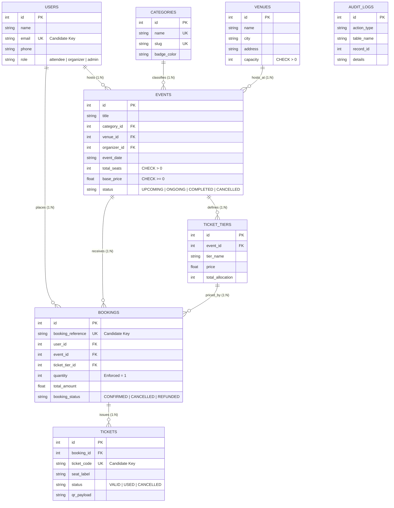
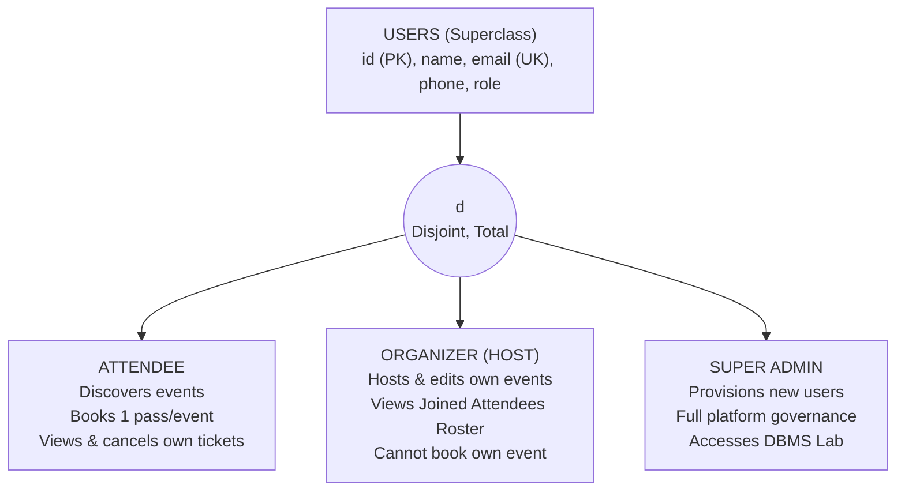
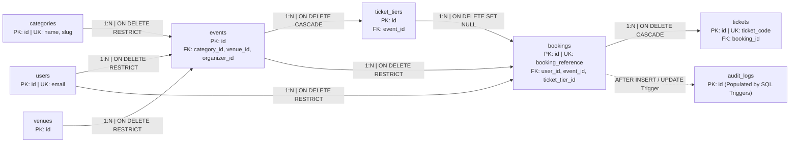
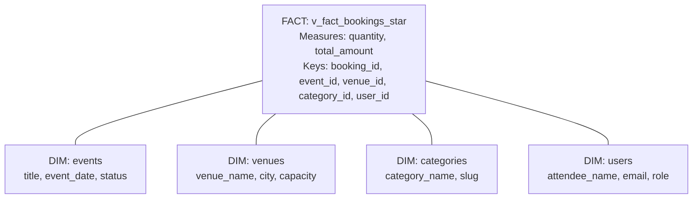
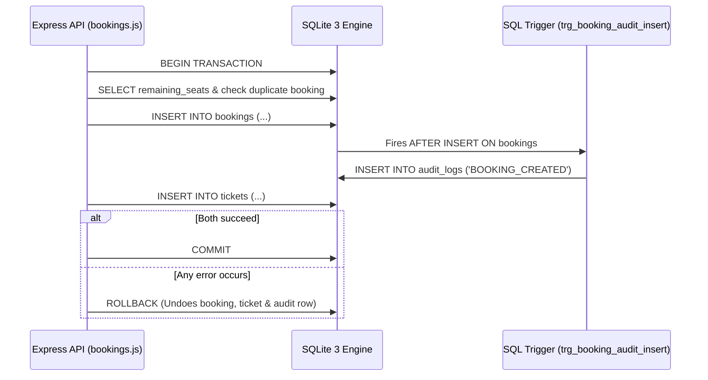
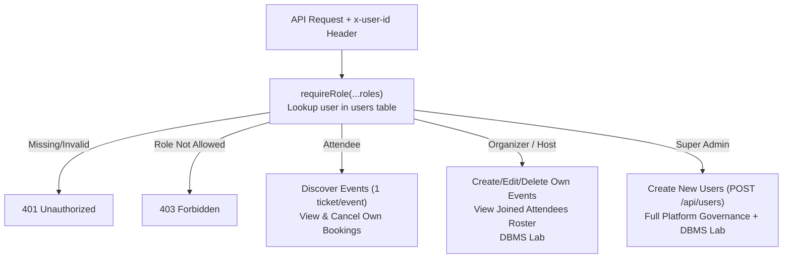

# EventSphere — Event & Ticket Booking Platform (DBMS Viva & Architecture Guide)

**EventSphere** is a full-stack Event Discovery, Ticket Booking, and Organizer Management platform engineered to demonstrate core **Database Management System (DBMS)** concepts across **Units 1–4** (Relational & EER Modeling, BCNF Normalization, Star Schema, CTEs & Window Functions, ACID Transactions, SQL Triggers, RBAC Security, `EXPLAIN QUERY PLAN` Indexing, and NoSQL Comparison).

---

## Table of Contents
1. [Quick Start](#1-quick-start)
2. [ER & EER Diagrams (Entities, Cardinality & Specialization)](#2-er--eer-diagrams)
3. [Relational Schema & Foreign Key Cascade Map](#3-relational-schema--foreign-key-cascade-map)
4. [Why Every Table, Key & Cascade Exists](#4-why-every-table-key--cascade-exists)
5. [Normalization Proof (1NF → 2NF → 3NF → BCNF)](#5-normalization-proof-1nf--2nf--3nf--bcnf)
6. [Star Schema for BI Analytics (Unit 1 & 2)](#6-star-schema-for-bi-analytics)
7. [ACID Transactions & SQL Triggers (Unit 3)](#7-acid-transactions--sql-triggers)
8. [Role-Based Access Control (RBAC) & 3-Role Abstraction](#8-role-based-access-control-rbac--3-role-abstraction)
9. [Why Both SQLite (`schema_sqlite.sql`) and MySQL (`schema.sql`) Exist](#9-why-both-sqlite-and-mysql-schemas-exist)
10. [Viva Preparation: Syllabus Unit-by-Unit Deep Dives & Q&A](#10-viva-preparation-syllabus-deep-dives--qa)

---

## 1. Quick Start

```bash
# 1. Start Backend (Express + SQLite 3, auto-creates & seeds eventsphere.db)
cd backend
npm install
node server.js
# Server: http://localhost:5000

# 2. Start Frontend (React + Vite)
cd ../frontend
npm install
npm run dev
# App: http://localhost:5174
```

- **Default Seed Accounts:**
  - **Attendee:** `Sarah Jenkins` (`sarah.j@example.com`) — *Discover Events, Book 1 Ticket/Event, My Tickets*
  - **Host (Organizer):** `Ishan Rawat` (`ishan.rawat@eventsphere.io`) — *Organizer Hub, Joined Attendees Roster, Host Event, DBMS Lab*
  - **Super Admin:** `Super Admin` (`admin@eventsphere.io`) — *Provision New Users, Full Platform Governance, DBMS Lab*

---

## 2. ER & EER Diagrams

### 2.1 Entity-Relationship (ER) Diagram with Cardinalities (`1:N`)
> **Key Design Note:** The `M:N` relationship between `USERS` (Attendees) and `EVENTS` is resolved through the associative entity **`BOOKINGS`** (`USERS 1:N BOOKINGS` and `EVENTS 1:N BOOKINGS`), with application logic enforcing **at most 1 active (`CONFIRMED`) ticket per user per event**.



### 2.2 EER Diagram: Generalization / Specialization (`users`)


---

## 3. Relational Schema & Foreign Key Cascade Map



---

## 4. Why Every Table, Key & Cascade Exists

### 4.1 Why Each Table Exists
| Table | Purpose | Why Not Merge It Elsewhere? |
| :--- | :--- | :--- |
| `venues` | Reusable physical locations with `capacity`. | Merging into `events` would duplicate address/capacity across every event at the same venue (3NF violation). |
| `categories` | Event taxonomy (`slug`, `badge_color`). | Ensures consistent filtering and avoids typo-prone category strings in `events`. |
| `users` | Unified accounts (`attendee`, `organizer`, `admin`). | Single authentication/RBAC table instead of 3 separate user tables with duplicate `email` checks. |
| `events` | Core event schedule, seat cap, and base price. | Central entity linking `categories`, `venues`, and `users`. |
| `ticket_tiers` | Event-specific pricing tiers (`VIP`, `Standard`). | An event can have 1 or many tiers; keeping tiers separate preserves 1NF. |
| `bookings` | Transactional order record & payment snapshot. | Resolves `M:N` between `users` and `events`, storing historical `unit_price` at purchase time. |
| `tickets` | Individual scannable pass (`ticket_code`, `qr_payload`). | Separating passes from `bookings` satisfies 1NF (atomic rows) and allows per-ticket check-in status (`VALID` / `USED`). |
| `audit_logs` | Immutable compliance trail. | Populated automatically by database triggers (`trg_booking_audit_*`), independent of app code. |

### 4.2 Why Surrogate Integer Primary Keys (`id`) Instead of Natural Keys?
- **Compactness & Join Speed:** An integer `id` (`4–8 bytes`) keeps `bookings` and `tickets` B-Tree indexes small and fast compared to repeating a 35-character `email` or `title` as a Foreign Key.
- **Immutability:** Users can change their `email`, and organizers can rename an `event` or `category` without cascading primary-key rewrites across child tables.
- **Candidate Keys Preserved:** Natural unique identifiers (`email`, `slug`, `booking_reference`, `ticket_code`) are enforced via `UNIQUE` constraints and indexed automatically.

### 4.3 Why Each Foreign Key Action (`RESTRICT` vs `CASCADE` vs `SET NULL` vs Normal `DELETE`)?
A normal `DELETE FROM parent WHERE id = 1;` is just a DML command. What happens to **child rows** depends on the Foreign Key's `ON DELETE` rule (enforced in SQLite via `PRAGMA foreign_keys = ON;` in `backend/database/db.js`):

| Action on `DELETE FROM parent WHERE id = 1` | What Happens to Child Rows? | Parent Deleted? | EventSphere Example |
| :--- | :--- | :--- | :--- |
| **Normal `DELETE` (No FK constraint)** | Left behind as **orphan rows** (corrupts referential integrity) | Yes | — |
| **`ON DELETE RESTRICT`** | **Blocks** the `DELETE` (`FOREIGN KEY constraint failed`) if children exist | **No** | Deleting an `event` is blocked if `bookings` exist (`events → categories/venues/users`, `bookings → users/events`) |
| **`ON DELETE CASCADE`** | Child rows are **automatically deleted** | Yes | Deleting a `booking` auto-deletes its `tickets` (`ticket_tiers → events`, `tickets → bookings`) |
| **`ON DELETE SET NULL`** | Child FK column is set to `NULL` (row stays intact) | Yes | Retiring a `ticket_tier` sets `bookings.ticket_tier_id = NULL`, preserving historical `unit_price` & `total_amount` |

---

## 5. Normalization Proof (1NF → 2NF → 3NF → BCNF)

1. **First Normal Form (1NF):**
   - Every column is atomic (no arrays or comma-separated lists of tickets inside `bookings`; each ticket is a row in `tickets`).
2. **Second Normal Form (2NF):**
   - Every table has a single-attribute Primary Key (`id`), eliminating partial functional dependencies.
3. **Third Normal Form (3NF):**
   - Zero transitive dependencies: `events` stores `venue_id` (not `venue_city` or `venue_capacity`), and `bookings` stores `user_id` (not `user_email`).
   - *(Viva Note: `bookings.unit_price` and `total_amount` are **intentional historical snapshots** frozen at checkout time—not transitive dependencies on `ticket_tiers.price`, which can change later.)*
4. **Boyce-Codd Normal Form (BCNF):**
   - For every non-trivial functional dependency $X \rightarrow Y$, $X$ is a superkey (`id`, `email`, `slug`, `booking_reference`, `ticket_code`).

---

## 6. Star Schema for BI Analytics



- **Why OLTP (BCNF) + Star Schema (`v_fact_bookings_star` View)?**
  - Writes hit **BCNF** tables to guarantee zero anomalies; analytics (`GET /api/dbms/overview`) query the **`v_fact_bookings_star`** view + `WITH` CTE + `RANK() OVER` window functions without duplicating data.

---

## 7. ACID Transactions & SQL Triggers



---

## 8. Role-Based Access Control (RBAC) & 3-Role Abstraction



---

## 9. Why Both SQLite and MySQL Schemas Exist

- `backend/database/` contains **`schema.sql` / `seed.sql`** (MySQL 8.0 syntax: `AUTO_INCREMENT`, `ENUM`, `INSERT IGNORE`) and **`schema_sqlite.sql` / `seed_sqlite.sql`** (SQLite 3 syntax: `AUTOINCREMENT`, `CHECK`, `INSERT OR IGNORE`).
- **Why:** EventSphere was originally designed for MySQL 8.0 and paired with SQLite 3 so anyone can run `node server.js` locally with **zero database installation**. To keep the backend code simple and focused on the DBMS syllabus, `backend/database/db.js` runs directly on embedded SQLite 3 at runtime while preserving the MySQL DDL for comparison and MySQL Workbench demos.

---

## 10. Viva Preparation: Syllabus Deep Dives & Q&A

Detailed unit-by-unit study guides mapped directly to EventSphere's files:
- **[Unit 1: Database Design & Relational Model](docs/unit-1-database-design-and-relational-model.md)** — DBMS vs File Systems, Codd's Rules, ER/EER, Keys, Cascades, Normalization (1NF–BCNF), Star Schema.
- **[Unit 2: SQL Queries & Advanced Operations](docs/unit-2-sql-queries-and-advanced-operations.md)** — DDL/DML/DCL/TCL, Joins, Correlated Subqueries, Views, B-Tree Indexes, CTEs & Window Functions.
- **[Unit 3: Transactions, Triggers & Database Security](docs/unit-3-transactions-triggers-and-security.md)** — ACID (`BEGIN TRANSACTION`/`COMMIT`/`ROLLBACK`), SQL Triggers (`audit_logs`), RBAC (`requireRole`), SQL Injection Prevention.
- **[Unit 4: Performance, NoSQL & Real-World Applications](docs/unit-4-performance-nosql-and-cloud.md)** — `EXPLAIN QUERY PLAN`, B-Tree vs Hash Indexing, RDBMS vs NoSQL Document Store (`fallbackApi.js`), OLTP vs OLAP/Cloud.

### Top 5 Viva Questions & Answers
1. **Why did you use `ON DELETE RESTRICT` on `bookings.event_id` instead of `CASCADE`?**
   - Deleting an event should never silently erase paid booking records; `RESTRICT` forces the organizer to cancel/refund active bookings first.
2. **Why store `unit_price` in `bookings` if it already exists in `ticket_tiers`?**
   - It is an intentional historical snapshot: if an organizer later raises ticket prices, existing receipts must still reflect what the attendee actually paid.
3. **How do you prevent overselling the last seat?**
   - `POST /api/bookings` checks remaining seats and inserts both `bookings` and `tickets` inside an atomic `BEGIN TRANSACTION ... COMMIT / ROLLBACK` block.
4. **Why use a Window Function (`RANK() OVER`) instead of just `GROUP BY`?**
   - `GROUP BY` collapses rows, whereas `RANK() OVER (ORDER BY revenue DESC)` and `SUM(revenue) OVER ()` compute rankings and platform totals alongside each event row.
5. **How does `EXPLAIN QUERY PLAN` prove your indexes work?**
   - In **DBMS Lab**, `EXPLAIN QUERY PLAN` on `WHERE status = 'UPCOMING'` outputs `SEARCH events USING INDEX idx_events_status`, proving an $O(\log N)$ B-Tree lookup instead of a full table scan.


---

## 11. Complete DBMS Syllabus Glossary & Theory Reference (From Basics)

Use this section to revise **every single DBMS term and keyword** from Units 1–4 from the ground up.

### 11.1 Unit 1: Keys, ER Concepts & Schemas (Explained from Scratch)

#### Every Type of Key (With Simple Examples)
Imagine a `users` table: `(id, email, phone, name)`.
1. **Super Key:** Any column or combination of columns that uniquely identifies a row.
   - Example: `{id}`, `{email}`, `{id, name}`, `{email, phone}` are all Super Keys.
2. **Candidate Key:** A **minimal** Super Key (no unnecessary extra columns).
   - Example: `{id}` and `{email}` are Candidate Keys. (`{id, name}` is NOT minimal because `id` alone already uniquely identifies the row.)
3. **Primary Key (PK):** The **one** Candidate Key chosen by the designer to officially identify rows (`NOT NULL` + `UNIQUE`).
   - Example: `id` in `users`.
4. **Alternate Key:** Any Candidate Key that was **not** chosen as the Primary Key.
   - Example: `email` in `users` (still `UNIQUE`, just not the PK).
5. **Foreign Key (FK):** A column in a child table that points to the Primary Key (or Unique Key) of a parent table to enforce **Referential Integrity**.
   - Example: `bookings.user_id` → `users.id`.
6. **Composite Key:** A Primary Key made of **2 or more columns** combined (e.g., `(student_id, course_id)` in an enrollment table).
7. **Natural Key vs. Surrogate Key:**
   - **Natural Key:** A real-world business value used as the PK (e.g., `email`, `SSN`, `ISBN`). *Downside:* can change (user updates email) and is often a long string (slower joins).
   - **Surrogate Key:** A system-generated meaningless integer (`id = 1, 2, 3...` via `AUTOINCREMENT`). *Why EventSphere uses Surrogate PKs:* fast integer B-Tree joins and never breaks if an email or event title changes.

#### ER & EER Modeling Terms
- **Entity:** A real-world object or concept stored as a table (`events`, `users`, `venues`).
  - **Strong Entity:** Exists independently with its own PK (`events`, `users`).
  - **Weak Entity:** Depends on a parent entity for existence (`tickets` depends on `bookings`).
- **Attributes:** Properties of an entity:
  - **Simple (Atomic):** Cannot be split (`base_price`).
  - **Composite:** Can be split into sub-parts (`address` → street, city, state).
  - **Derived:** Calculated from other data (`remaining_seats = total_seats - booked_seats`, `age` from `DOB`).
  - **Multi-valued:** Multiple values for one entity (a user having multiple phone numbers—stored as separate rows in 1NF).
- **Generalization (Bottom-Up):** Combining similar entities (`Attendee`, `Organizer`, `Admin`) into one parent entity (`users`).
- **Specialization (Top-Down):** Splitting a parent entity (`users`) into distinct sub-roles based on `role`.
- **Aggregation:** Treating a **relationship itself as a higher-level entity** so another relationship can connect to it (e.g., `User — books — Event` produces a `Booking` interaction, which then connects to `Audit_Log` or `Payment`).

#### Star Schema vs. Snowflake Schema
- **Star Schema:** 1 central **Fact table** (numeric measures like `quantity`, `total_amount`) connected directly to **denormalized Dimension tables** (`events`, `venues`, `categories`, `users`). *Fastest for BI queries (fewer joins).*
- **Snowflake Schema:** Dimension tables are **normalized further** into sub-tables (e.g., `venues` → `cities` → `states` → `countries`). *Saves storage, but requires more joins.*

---

### 11.2 Unit 2: SQL Commands, Joins, Set Operations & Views

#### DDL vs. DML vs. DCL vs. TCL
- **DDL (Data Definition Language):** Defines/changes structure (`CREATE`, `ALTER`, `DROP`, `TRUNCATE`). Auto-commits.
- **DML (Data Manipulation Language):** Reads/modifies rows (`SELECT`, `INSERT`, `UPDATE`, `DELETE`). Can be rolled back inside a transaction.
- **DCL (Data Control Language):** Controls permissions (`GRANT`, `REVOKE`).
- **TCL (Transaction Control Language):** Manages transactions (`BEGIN TRANSACTION`, `COMMIT`, `ROLLBACK`, `SAVEPOINT`).

#### All Types of Joins
- **`INNER JOIN`:** Returns **only** rows that match in both tables (e.g., events that have a valid venue).
- **`LEFT (OUTER) JOIN`:** Returns **all** rows from the left table + matching rows from the right (or `NULL` if no match). *Used in EventSphere so events with `0` bookings still appear!*
- **`RIGHT (OUTER) JOIN`:** Returns **all** rows from the right table + matching rows from the left.
- **`FULL OUTER JOIN`:** Returns all rows when there is a match in **either** left or right table (`NULL` where missing).
- **Self Join:** Joining a table **to itself** (e.g., finding two events at the same venue on the same date: `FROM events e1 JOIN events e2 ON e1.venue_id = e2.venue_id AND e1.id <> e2.id`).

#### Set Operations (Combine 2 `SELECT`s with Same Columns)
- **`UNION`:** Combines results and **removes duplicates**.
- **`UNION ALL`:** Combines results and **keeps duplicates** (faster).
- **`INTERSECT`:** Returns rows present in **both** queries.
- **`EXCEPT` (or `MINUS` in Oracle):** Returns rows in the first query that are **not** in the second (e.g., users who have **never** booked an event).

#### Subqueries, Views, CTEs & Window Functions
- **Subquery:** A `SELECT` nested inside another query. A **Correlated Subquery** references a column from the outer query and runs once per outer row.
- **View (`CREATE VIEW`):** A saved virtual table (stores the query, not the data). A **Materialized View** caches the physical result on disk for speed.
- **CTE (`WITH name AS (...)`):** A temporary named result set scoped to one query—cleaner than nested subqueries.
- **Window Functions (`OVER (...)`):** Calculate rankings/totals **across related rows without collapsing them**:
  - `ROW_NUMBER()`: `1, 2, 3, 4` (unique sequence)
  - `RANK()`: `1, 2, 2, 4` (ties get same rank, skips next)
  - `DENSE_RANK()`: `1, 2, 2, 3` (ties get same rank, no gap)

---

### 11.3 Unit 3: Transactions, `ROLLBACK`, `SAVEPOINT`, Locking, PL/SQL & Security

#### `COMMIT`, `ROLLBACK`, and `SAVEPOINT`
- **`BEGIN TRANSACTION`:** Starts an atomic unit of work.
- **`COMMIT`:** Permanently saves all changes made since `BEGIN TRANSACTION`.
- **`ROLLBACK`:** Undoes **all** uncommitted changes since `BEGIN TRANSACTION` if anything fails.
- **`SAVEPOINT name`:** Sets an intermediate checkpoint **inside** a transaction so you can undo part of the work (`ROLLBACK TO SAVEPOINT name`) without losing earlier steps:
  ```sql
  BEGIN TRANSACTION;
  INSERT INTO bookings (...) VALUES (...);   -- Step 1
  SAVEPOINT after_booking;
  INSERT INTO tickets (...) VALUES (...);    -- Step 2 (suppose this fails)
  ROLLBACK TO SAVEPOINT after_booking;       -- Undoes Step 2 only, keeps Step 1!
  COMMIT;
  ```

#### Concurrency Problems & 4 Isolation Levels
1. **Dirty Read:** Reading uncommitted data from another transaction that later rolls back.
2. **Non-Repeatable Read:** Reading the same row twice in one transaction and getting different values because another transaction updated and committed it in between.
3. **Phantom Read:** Running the same `WHERE` range query twice and seeing new rows inserted by another transaction.

| Isolation Level | Dirty Read? | Non-Repeatable Read? | Phantom Read? |
| :--- | :--- | :--- | :--- |
| **`READ UNCOMMITTED`** | Possible | Possible | Possible |
| **`READ COMMITTED`** | Prevented | Possible | Possible |
| **`REPEATABLE READ`** | Prevented | Prevented | Possible (Prevented in MySQL InnoDB) |
| **`SERIALIZABLE`** | Prevented | Prevented | Prevented (Strictest, slowest) |

#### Locking & Deadlocks
- **Shared Lock (`S`):** Multiple transactions can **read** a row simultaneously, but none can write.
- **Exclusive Lock (`X`):** Only **one** transaction can **write** (update/delete) a row; blocks other reads/writes until `COMMIT`/`ROLLBACK`.
- **Pessimistic Locking:** Locks rows *before* reading/updating (`SELECT ... FOR UPDATE`), assuming conflicts will happen.
- **Optimistic Locking:** Reads without locking, then checks a `version` / `updated_at` column on write (`WHERE id = ? AND version = ?`) and retries if someone else modified it.
- **Deadlock:** Two transactions wait on each other's locks forever ($T_1$ holds $A$ and wants $B$; $T_2$ holds $B$ and wants $A$). Resolved by **Deadlock Detection** (wait-for graph → abort victim transaction) or **Lock Timeouts**.

#### PL/SQL Concepts (Stored Procedures, Functions, Cursors, Triggers)
- **Stored Procedure:** Precompiled SQL block stored in the DB (`CALL book_ticket(...)`); can perform DML and return multiple outputs, not usable directly inside `SELECT`.
- **Function:** Stored block that **must return a single value** and can be called inside a `SELECT` expression.
- **Cursor:** A pointer that iterates **row-by-row** over a `SELECT` result set inside procedural SQL (`OPEN`, `FETCH`, `CLOSE`).
- **Trigger:** Event-driven SQL block that fires **automatically** `BEFORE` or `AFTER` an `INSERT`, `UPDATE`, or `DELETE` (like EventSphere's `trg_booking_audit_insert` & `trg_booking_audit_cancel`).

#### Database Security
- **SQL Injection:** Attackers inject malicious SQL via unsanitized input (e.g. `' OR '1'='1`). **Prevention:** Always use **Parameterized Queries (`?`)** so the DB treats input strictly as data, never executable SQL.
- **RBAC (Role-Based Access Control):** Assign permissions to **roles** (`attendee`, `organizer`, `admin`) rather than individual users.

---

### 11.4 Unit 4: Indexing, NoSQL, Cloud & Data Warehousing

#### Indexing: B-Tree vs. Hash
- **B-Tree (Balanced Tree) Index:** Keeps keys sorted in a multi-level tree ($O(\log N)$ lookup). Supports `=`, `<`, `>`, `BETWEEN`, `LIKE 'AI%'`, and `ORDER BY`. *(Default in SQLite & MySQL InnoDB.)*
- **Hash Index:** Uses a hash function for $O(1)$ exact-match (`=`) lookups. *Cannot* do range queries (`>`) or sorting (`ORDER BY`).
- **Execution Plan (`EXPLAIN` / `EXPLAIN QUERY PLAN`):** Shows whether the query optimizer uses an index (`SEARCH ... USING INDEX`) or a slow full-table scan (`SCAN`).

#### NoSQL Database Types
1. **Key-Value Store (e.g., Redis, DynamoDB):** Ultra-fast `key → value` lookup; ideal for caching, sessions, and temporary seat-hold locks.
2. **Document Store (e.g., MongoDB, Firebase Firestore):** Stores nested JSON/BSON documents; schema-flexible, avoids joins (like EventSphere's `bookings_nosql` view & `fallbackApi.js`).
3. **Column-Family Store (e.g., Apache Cassandra):** Stores data by columns for massive write-heavy analytics/time-series.
4. **Graph Database (e.g., Neo4j):** Stores nodes and edges for social networks, recommendations, and fraud rings.

#### Cloud Databases & Data Warehousing
- **Cloud Managed RDBMS:** **AWS RDS** (managed MySQL/Postgres), **Azure SQL** (managed SQL Server).
- **Cloud Data Warehouses:** **Google BigQuery**, **Snowflake** (columnar storage built for petabyte-scale OLAP).
- **ETL (Extract, Transform, Load):** Pipeline that **Extracts** data from OLTP databases, **Transforms** (cleans/aggregates) it, and **Loads** it into a Data Warehouse.
- **Data Warehouse vs. Data Lake:**
  - **Data Warehouse:** Stores **structured, cleaned** data (**Schema-on-Write**) for BI dashboards and SQL analytics (OLAP).
  - **Data Lake:** Stores **raw** structured, semi-structured (JSON), and unstructured (images/logs) data (**Schema-on-Read**) at low cost for ML/big data.
