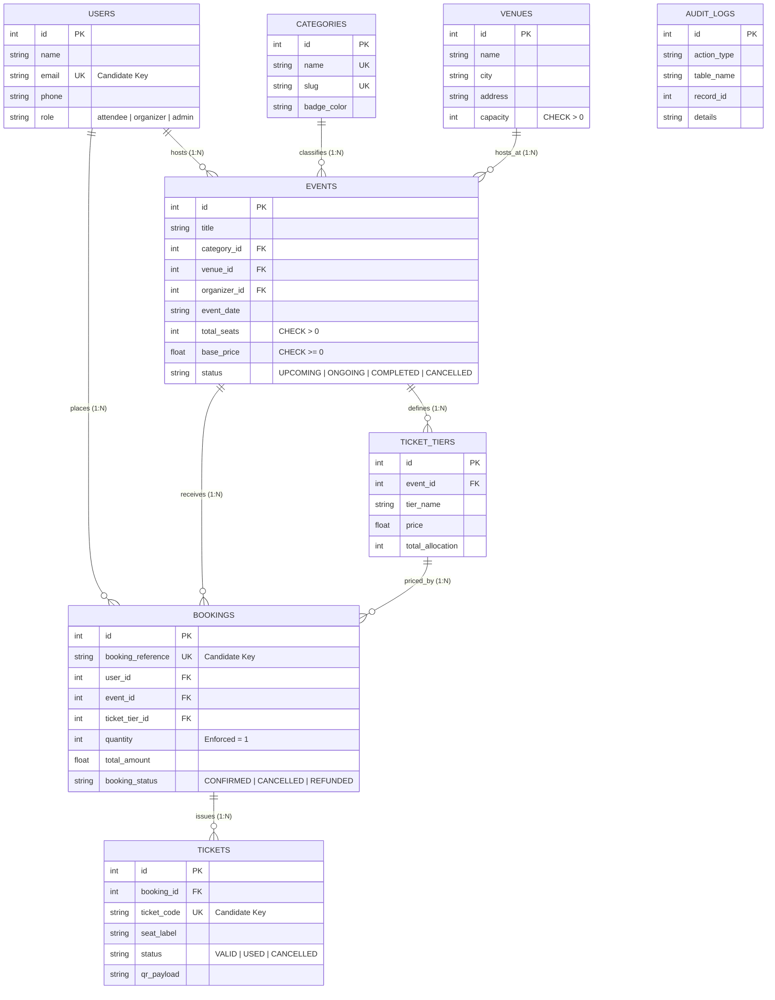
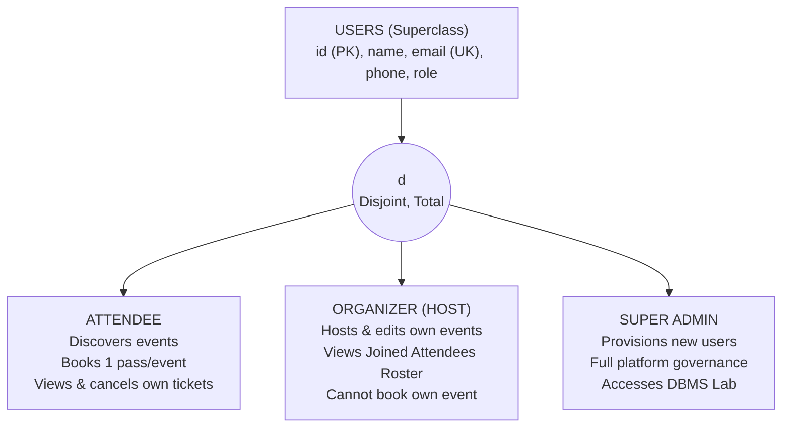
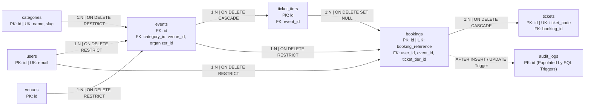
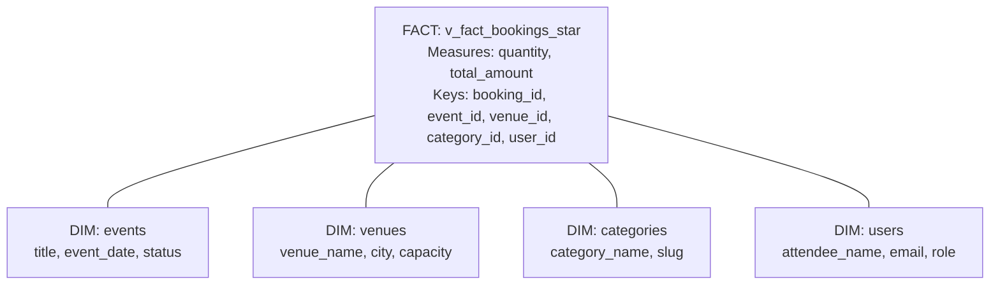
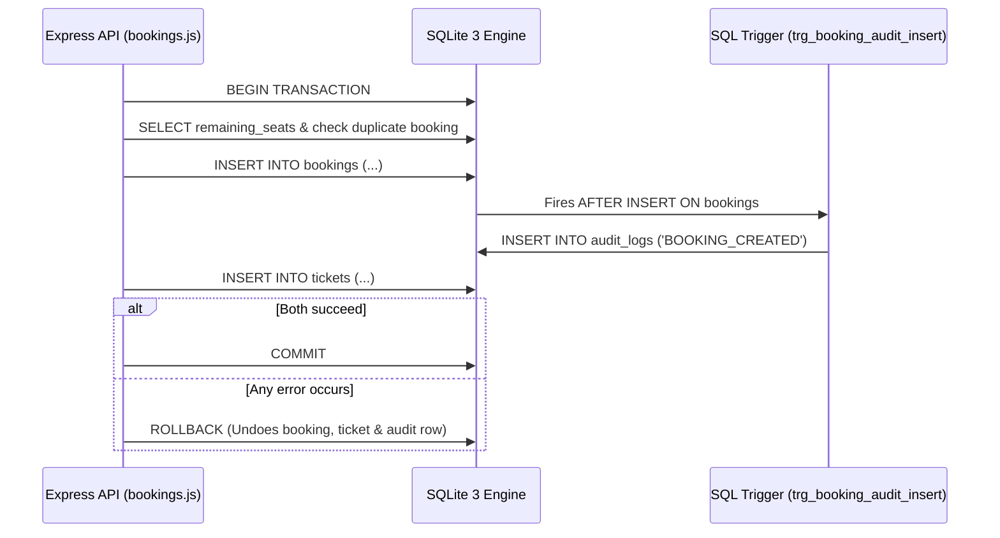
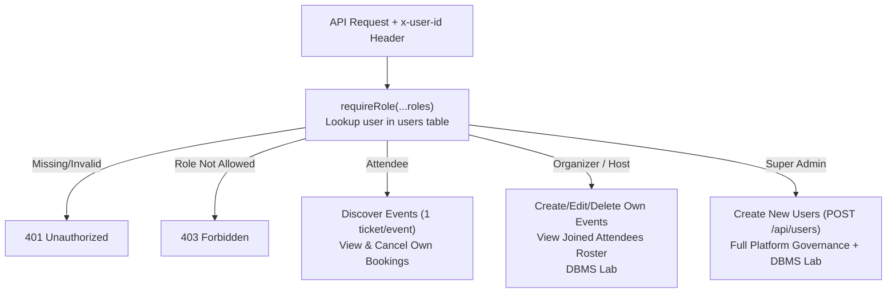

# EventSphere — Event & Ticket Booking Platform (DBMS Viva & Architecture Guide)

**EventSphere** is a full-stack Event Discovery, Ticket Booking, and Organizer Management platform engineered to demonstrate core **Database Management System (DBMS)** concepts across **Units 1–4** (Relational & EER Modeling, BCNF Normalization, Star Schema, CTEs & Window Functions, ACID Transactions, SQL Triggers, RBAC Security, `EXPLAIN QUERY PLAN` Indexing, and NoSQL Comparison).

---

## Table of Contents
1. [Quick Start](#1-quick-start)
2. [ER & EER Diagrams (Entities, Cardinality & Specialization)](#2-er--eer-diagrams)
3. [Relational Schema & Foreign Key Cascade Map](#3-relational-schema--foreign-key-cascade-map)
4. [Why Every Table, Key & Cascade Exists](#4-why-every-table-key--cascade-exists)
5. [Normalization Proof (1NF → 2NF → 3NF → BCNF)](#5-normalization-proof-1nf--2nf--3nf--bcnf)
6. [Star Schema for BI Analytics (Unit 1 & 2)](#6-star-schema-for-bi-analytics)
7. [ACID Transactions & SQL Triggers (Unit 3)](#7-acid-transactions--sql-triggers)
8. [Role-Based Access Control (RBAC) & 3-Role Abstraction](#8-role-based-access-control-rbac--3-role-abstraction)
9. [Why Both SQLite (`schema_sqlite.sql`) and MySQL (`schema.sql`) Exist](#9-why-both-sqlite-and-mysql-schemas-exist)
10. [Viva Preparation: Syllabus Unit-by-Unit Deep Dives & Q&A](#10-viva-preparation-syllabus-deep-dives--qa)

---

## 1. Quick Start

```bash
# 1. Start Backend (Express + SQLite 3, auto-creates & seeds eventsphere.db)
cd backend
npm install
node server.js
# Server: http://localhost:5000

# 2. Start Frontend (React + Vite)
cd ../frontend
npm install
npm run dev
# App: http://localhost:5174
```

- **Default Seed Accounts:**
  - **Attendee:** `Sarah Jenkins` (`sarah.j@example.com`) — *Discover Events, Book 1 Ticket/Event, My Tickets*
  - **Host (Organizer):** `Ishan Rawat` (`ishan.rawat@eventsphere.io`) — *Organizer Hub, Joined Attendees Roster, Host Event, DBMS Lab*
  - **Super Admin:** `Super Admin` (`admin@eventsphere.io`) — *Provision New Users, Full Platform Governance, DBMS Lab*

---

## 2. ER & EER Diagrams

### 2.1 Entity-Relationship (ER) Diagram with Cardinalities (`1:N`)
> **Key Design Note:** The `M:N` relationship between `USERS` (Attendees) and `EVENTS` is resolved through the associative entity **`BOOKINGS`** (`USERS 1:N BOOKINGS` and `EVENTS 1:N BOOKINGS`), with application logic enforcing **at most 1 active (`CONFIRMED`) ticket per user per event**.



### 2.2 EER Diagram: Generalization / Specialization (`users`)


---

## 3. Relational Schema & Foreign Key Cascade Map



---

## 4. Why Every Table, Key & Cascade Exists

### 4.1 Why Each Table Exists
| Table | Purpose | Why Not Merge It Elsewhere? |
| :--- | :--- | :--- |
| `venues` | Reusable physical locations with `capacity`. | Merging into `events` would duplicate address/capacity across every event at the same venue (3NF violation). |
| `categories` | Event taxonomy (`slug`, `badge_color`). | Ensures consistent filtering and avoids typo-prone category strings in `events`. |
| `users` | Unified accounts (`attendee`, `organizer`, `admin`). | Single authentication/RBAC table instead of 3 separate user tables with duplicate `email` checks. |
| `events` | Core event schedule, seat cap, and base price. | Central entity linking `categories`, `venues`, and `users`. |
| `ticket_tiers` | Event-specific pricing tiers (`VIP`, `Standard`). | An event can have 1 or many tiers; keeping tiers separate preserves 1NF. |
| `bookings` | Transactional order record & payment snapshot. | Resolves `M:N` between `users` and `events`, storing historical `unit_price` at purchase time. |
| `tickets` | Individual scannable pass (`ticket_code`, `qr_payload`). | Separating passes from `bookings` satisfies 1NF (atomic rows) and allows per-ticket check-in status (`VALID` / `USED`). |
| `audit_logs` | Immutable compliance trail. | Populated automatically by database triggers (`trg_booking_audit_*`), independent of app code. |

### 4.2 Why Surrogate Integer Primary Keys (`id`) Instead of Natural Keys?
- **Compactness & Join Speed:** An integer `id` (`4–8 bytes`) keeps `bookings` and `tickets` B-Tree indexes small and fast compared to repeating a 35-character `email` or `title` as a Foreign Key.
- **Immutability:** Users can change their `email`, and organizers can rename an `event` or `category` without cascading primary-key rewrites across child tables.
- **Candidate Keys Preserved:** Natural unique identifiers (`email`, `slug`, `booking_reference`, `ticket_code`) are enforced via `UNIQUE` constraints and indexed automatically.

### 4.3 Why Each Foreign Key Action (`RESTRICT` vs `CASCADE` vs `SET NULL`)?
- **`ON DELETE RESTRICT`** (`events → categories/venues/users`, `bookings → users/events`):
  - **Why:** Protects financial and operational history. You cannot accidentally delete a venue, category, or user while active events or bookings reference them.
- **`ON DELETE CASCADE`** (`ticket_tiers → events`, `tickets → bookings`):
  - **Why:** Weak/dependent child entities have no standalone meaning if their parent is deleted.
- **`ON DELETE SET NULL`** (`bookings.ticket_tier_id → ticket_tiers.id`):
  - **Why:** If an organizer retires a ticket tier, historical `bookings` rows remain valid for accounting (`unit_price` and `total_amount` are already snapshotted on `bookings`).

---

## 5. Normalization Proof (1NF → 2NF → 3NF → BCNF)

1. **First Normal Form (1NF):**
   - Every column is atomic (no arrays or comma-separated lists of tickets inside `bookings`; each ticket is a row in `tickets`).
2. **Second Normal Form (2NF):**
   - Every table has a single-attribute Primary Key (`id`), eliminating partial functional dependencies.
3. **Third Normal Form (3NF):**
   - Zero transitive dependencies: `events` stores `venue_id` (not `venue_city` or `venue_capacity`), and `bookings` stores `user_id` (not `user_email`).
   - *(Viva Note: `bookings.unit_price` and `total_amount` are **intentional historical snapshots** frozen at checkout time—not transitive dependencies on `ticket_tiers.price`, which can change later.)*
4. **Boyce-Codd Normal Form (BCNF):**
   - For every non-trivial functional dependency $X \rightarrow Y$, $X$ is a superkey (`id`, `email`, `slug`, `booking_reference`, `ticket_code`).

---

## 6. Star Schema for BI Analytics



- **Why OLTP (BCNF) + Star Schema (`v_fact_bookings_star` View)?**
  - Writes hit **BCNF** tables to guarantee zero anomalies; analytics (`GET /api/dbms/overview`) query the **`v_fact_bookings_star`** view + `WITH` CTE + `RANK() OVER` window functions without duplicating data.

---

## 7. ACID Transactions & SQL Triggers



---

## 8. Role-Based Access Control (RBAC) & 3-Role Abstraction



---

## 9. Why Both SQLite and MySQL Schemas Exist

- `backend/database/` contains **`schema.sql` / `seed.sql`** (MySQL 8.0 syntax: `AUTO_INCREMENT`, `ENUM`, `INSERT IGNORE`) and **`schema_sqlite.sql` / `seed_sqlite.sql`** (SQLite 3 syntax: `AUTOINCREMENT`, `CHECK`, `INSERT OR IGNORE`).
- **Why:** EventSphere was originally designed for MySQL 8.0 and paired with SQLite 3 so anyone can run `node server.js` locally with **zero database installation**. To keep the backend code simple and focused on the DBMS syllabus, `backend/database/db.js` runs directly on embedded SQLite 3 at runtime while preserving the MySQL DDL for comparison and MySQL Workbench demos.

---

## 10. Viva Preparation: Syllabus Deep Dives & Q&A

Detailed unit-by-unit study guides mapped directly to EventSphere's files:
- **[Unit 1: Database Design & Relational Model](docs/unit-1-database-design-and-relational-model.md)** — DBMS vs File Systems, Codd's Rules, ER/EER, Keys, Cascades, Normalization (1NF–BCNF), Star Schema.
- **[Unit 2: SQL Queries & Advanced Operations](docs/unit-2-sql-queries-and-advanced-operations.md)** — DDL/DML/DCL/TCL, Joins, Correlated Subqueries, Views, B-Tree Indexes, CTEs & Window Functions.
- **[Unit 3: Transactions, Triggers & Database Security](docs/unit-3-transactions-triggers-and-security.md)** — ACID (`BEGIN TRANSACTION`/`COMMIT`/`ROLLBACK`), SQL Triggers (`audit_logs`), RBAC (`requireRole`), SQL Injection Prevention.
- **[Unit 4: Performance, NoSQL & Real-World Applications](docs/unit-4-performance-nosql-and-cloud.md)** — `EXPLAIN QUERY PLAN`, B-Tree vs Hash Indexing, RDBMS vs NoSQL Document Store (`fallbackApi.js`), OLTP vs OLAP/Cloud.

### Top 5 Viva Questions & Answers
1. **Why did you use `ON DELETE RESTRICT` on `bookings.event_id` instead of `CASCADE`?**
   - Deleting an event should never silently erase paid booking records; `RESTRICT` forces the organizer to cancel/refund active bookings first.
2. **Why store `unit_price` in `bookings` if it already exists in `ticket_tiers`?**
   - It is an intentional historical snapshot: if an organizer later raises ticket prices, existing receipts must still reflect what the attendee actually paid.
3. **How do you prevent overselling the last seat?**
   - `POST /api/bookings` checks remaining seats and inserts both `bookings` and `tickets` inside an atomic `BEGIN TRANSACTION ... COMMIT / ROLLBACK` block.
4. **Why use a Window Function (`RANK() OVER`) instead of just `GROUP BY`?**
   - `GROUP BY` collapses rows, whereas `RANK() OVER (ORDER BY revenue DESC)` and `SUM(revenue) OVER ()` compute rankings and platform totals alongside each event row.
5. **How does `EXPLAIN QUERY PLAN` prove your indexes work?**
   - In **DBMS Lab**, `EXPLAIN QUERY PLAN` on `WHERE status = 'UPCOMING'` outputs `SEARCH events USING INDEX idx_events_status`, proving an $O(\log N)$ B-Tree lookup instead of a full table scan.
